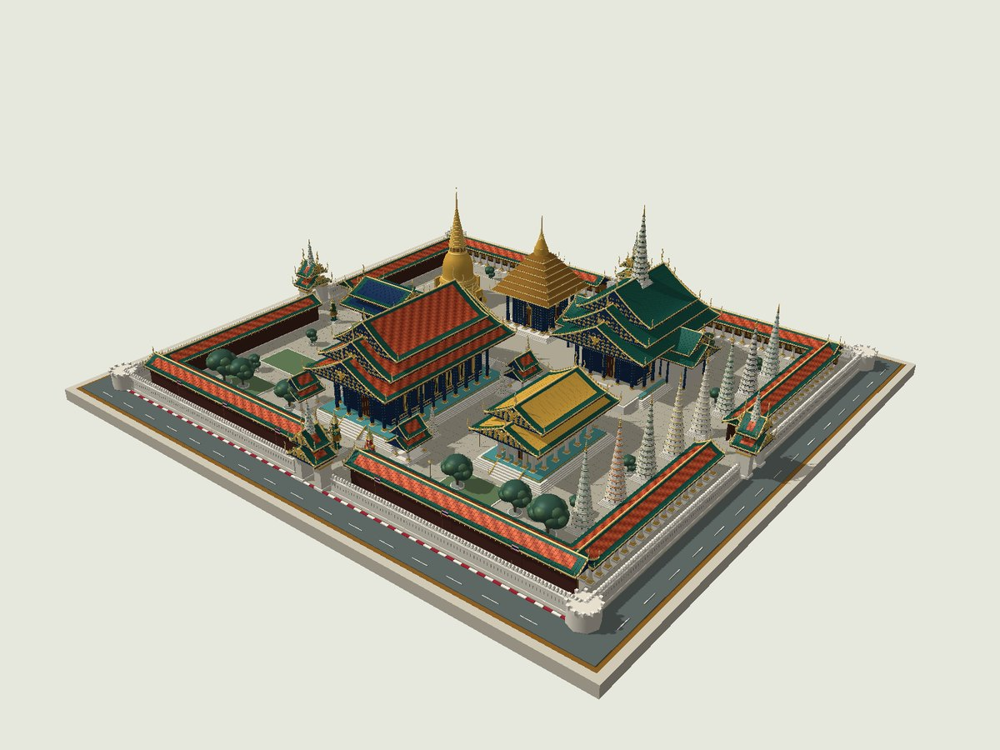
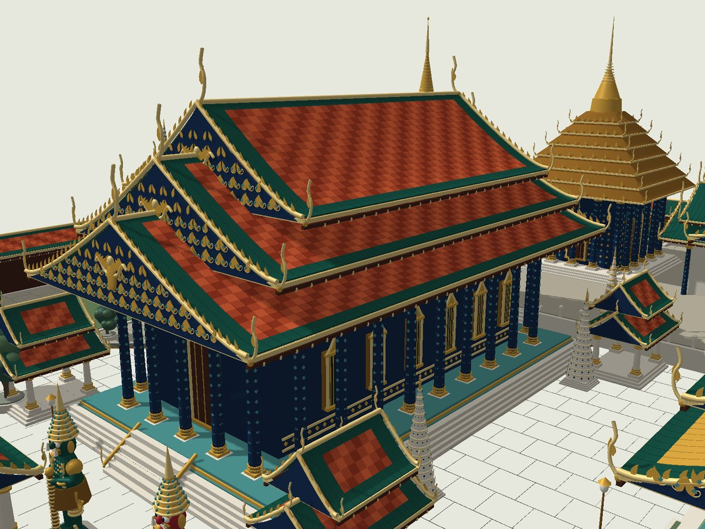

# 3D_1 — วัดพระแก้ว 3D

โมเดลวัดพระศรีรัตนศาสดาราม (วัดพระแก้ว) แบบ **procedural geometry** สร้างด้วย JavaScript / Three.js พร้อมตัวดูโมเดลภาษาไทยและส่งออก GLB ได้จริง ทั้งอาคาร กระเบื้อง ลวดลาย และรูปปั้นเป็นรูปทรงสามมิติ ไม่ใช่ภาพพื้นหลังหรือภาพ AI

> งานศึกษารูปทรงจากภาพอ้างอิงที่ผู้ใช้ให้มา ตำแหน่งอาคาร สัดส่วน ลวดลาย และพระพุทธรูปเป็นการตีความโดยประมาณ ไม่ใช่ photogrammetry, laser scan หรือแบบอนุรักษ์ที่ตรงมาตราส่วน ไม่ได้นำภาพอ้างอิงต้นฉบับมาเผยแพร่ใน repo



## เริ่มใช้งาน

โค้ดชุดนี้อยู่ใน branch `codex/wat-phra-kaew-3d` ระหว่างรอรวมเข้า `main`

ติดตั้ง **Node.js 20 ขึ้นไป** แล้วเปิด Terminal:

```bash
git clone --branch codex/wat-phra-kaew-3d https://github.com/Sukrit310/3D_1.git
cd 3D_1
npm ci
npm run dev
```

เปิด **http://localhost:5173** ใน Chrome, Edge, Firefox หรือ Safari ที่รองรับ **WebGL 2** และเปิด hardware acceleration อย่าดับเบิลคลิก `index.html` ผ่าน `file://` เพราะ ES modules ต้องใช้ HTTP server

หลังติดตั้ง dependencies แล้ว ตัวดูโมเดลไม่ต้องเชื่อมต่อ CDN, API, บริการภายนอก หรือโหลดภาพ texture จากอินเทอร์เน็ต

## สิ่งที่อยู่ในโมเดล

- **พระอุโบสถ:** หลังคา 3 ชั้น กระเบื้องสีส้มขอบเขียวรายแผ่น ช่อฟ้า ใบระกา หางหงส์ หน้าบันลายเปลวและเถาประดับ เสาโมเสก บัวหัวเสา กรอบหน้าต่างทอง ฐานและบันได
- **พระศรีรัตนเจดีย์:** ฐานบัวซ้อนชั้น องค์ระฆังทรงโค้ง ซุ้ม 4 ทิศ ปล้องไฉน 27 ชั้น และปลียอด
- **พระมณฑป:** ผนังโมเสก เสาล้อมรอบ หลังคาบุษบกซ้อนชั้นและยอดทอง
- **ปราสาทพระเทพบิดร:** หลังคาสีเขียว มุขยื่นและยอดปรางค์
- **พระอัษฎามหาเจดีย์:** พระปรางค์ 8 องค์ พร้อมชั้นกลีบและแถบกระเบื้องหลากสี
- ศาลา อาคารประกอบ เจดีย์ขนาดเล็ก พระระเบียง ทางเดินหิน สวน ต้นไม้ ธงไทย และเสาโคม
- **ยักษ์ทวารบาล:** ยักษ์เขียว/แดง มีมงกุฎ เกราะ โมเสก เขี้ยว มือ แขน และกระบอง
- **พระแก้วมรกตจำลอง:** รูปทรงเชิงสัญลักษณ์สีหยก ฐานทองและฉัตร อยู่ภายในพระอุโบสถ
- กำแพงใบเสมา ป้อมมุม และซุ้มประตูทั้ง 4 ด้าน



## วิธีควบคุม

| การกระทำ | วิธีใช้ |
| --- | --- |
| หมุนรอบโมเดล | ลากเมาส์ซ้าย / ลากด้วยนิ้วเดียว |
| ซูม | ล้อเมาส์ / กางหรือหุบนิ้ว 2 นิ้ว / ปุ่ม + − |
| เลื่อนจุดมอง | ลากเมาส์ขวา / ลากด้วย 2 นิ้ว |
| ไปยังอาคาร | เลือกชื่อในแถบด้านซ้าย (มือถืออยู่ด้านบน) |
| กลับภาพรวม | ปุ่มรูปบ้าน หรือปุ่ม `R` |
| ดูผังด้านบน | ปุ่มตาราง |
| เปิดดูภายใน | ปิดปุ่ม “หลังคา” หรือเลือก “พระแก้วมรกตจำลอง” |
| หมุนอัตโนมัติ / ป้ายชื่อ | ปุ่มด้านล่าง |
| เปลี่ยนแสง / คุณภาพ / กำแพง / wireframe | “การแสดงผล” |
| บันทึกภาพ | ปุ่มภาพ ดาวน์โหลด PNG จากมุมมองปัจจุบัน |
| ดาวน์โหลดโมเดล | “ส่งออกโมเดล” ดาวน์โหลด GLB ทั้งพระอาราม |

เลือกพระแก้วมรกตแล้วหลังคาจะเปิดค้างไว้ สามารถกด “หลังคา” เพื่อเปิดกลับได้

## ไฟล์โมเดลพร้อมใช้

ดาวน์โหลด [wat-phra-kaew-model.zip](models/wat-phra-kaew-model.zip) แล้วแตกไฟล์ จะได้ `wat-phra-kaew.glb` รายละเอียดสูง (ประมาณ 7.3 MB) และ `model-stats.json` เป็นโมเดลเดียวกับที่สร้างจากโค้ด ไม่ต้องรัน Node.js เพื่อใช้ไฟล์นี้

## ส่งออกไฟล์ 3D โดยไม่เปิดเบราว์เซอร์

```bash
npm run export
```

ได้ `exports/wat-phra-kaew.glb` และ `exports/model-stats.json` หรือใช้:

```bash
npm run export -- --balanced
```

GLB มี geometry, normals, PBR materials และสีครบ โดยไม่มี external textures ตัวส่งออกใช้ `EXT_mesh_gpu_instancing` เพื่อรักษารายละเอียดหลายหมื่นชิ้นด้วยขนาดไฟล์ที่เหมาะสม โปรแกรมปลายทางต้องรองรับ extension นี้ หากโปรแกรมแสดงชิ้นส่วนซ้ำไม่ครบ ให้ใช้ importer ที่รองรับ GPU instancing

ใน Blender ใช้ **File → Import → glTF 2.0 (.glb/.gltf)** และเลือกไฟล์ที่ส่งออก (ต้องเป็น Blender/importer รุ่นที่รองรับ extension ข้างต้น) เมื่อนำเข้าแล้วจึงบันทึกเป็น `.blend` ได้ โปรเจกต์นี้ไม่ได้ส่งออก `.blend` โดยตรง

โมเดลใช้ Y-up และหน่วยประมาณเมตร การส่งออกจะรวมทุกชั้นเสมอ แม้จะซ่อนหลังคาหรือกำแพงในตัวดูอยู่

## โครงสร้างโค้ด

| ไฟล์ | หน้าที่ |
| --- | --- |
| `src/model/temple.js` | ผังอาคาร จุดชม และประกอบพระอารามทั้งหมด |
| `src/model/architecture.js` | หลังคา อาคาร เสา เจดีย์ มณฑป ปรางค์ และพระพุทธรูป |
| `src/model/details.js` | ยักษ์ ต้นไม้ สวน กำแพง ซุ้ม พระระเบียง และธง |
| `src/model/geometry.js` | Primitive geometry, เส้นโค้ง, lathe, instancing และ batching |
| `src/model/materials.js` | วัสดุและสี PBR |
| `src/main.js` | กล้อง แสง เงา UI จุดชม และการควบคุม |
| `src/export.js` | ส่งออก GLB และดาวน์โหลดไฟล์ |
| `src/style.css` | หน้าตาตัวดูและ responsive layout |
| `scripts/serve.mjs` | Local HTTP server |
| `scripts/build.mjs` | สร้าง static bundle พร้อม Three.js ภายใน |
| `scripts/export-model.mjs` | สร้าง GLB ด้วย Node.js |
| `scripts/node-polyfills.mjs` | FileReader ที่ตัวส่งออกต้องใช้ใน Node.js |
| `test/model.test.mjs` | ทดสอบ geometry, detail levels และ GLB round-trip |

แก้ตำแหน่งและขนาดอาคารใน `buildTemple()` ได้โดยตรง ฟังก์ชันย่อยรับพารามิเตอร์ เช่น `width`, `length`, `height`, `tiers`, `roofColor`, `rotation` และ `scale`

## ประสิทธิภาพ

รายละเอียดสูงมีชิ้นส่วนราว **6 หมื่นชิ้น** และสามเหลี่ยมราว **2 ล้านหน้า** ใช้ `InstancedMesh` กับชิ้นส่วนซ้ำ และรวม geometry ที่ไม่ซ้ำตามวัสดุ เหลือชุดวาดประมาณ 370 ชุด (ไม่รวมรอบวาดเงา/สภาพแวดล้อม) มีคุณภาพ “สมดุล” สำหรับลดกระเบื้องและโมเสก ตัวเลขจริงดูในแผง “การแสดงผล” หรือ `model-stats.json`

## Build และตรวจสอบ

```bash
npm test
npm run build
npm run preview
```

`dist/` เป็น static website พร้อม dependencies ภายใน ใช้กับ static hosting ได้ รวมทั้งการวางใต้ subpath ของ GitHub Pages ไม่มีขั้นตอน deploy อัตโนมัติใน repo

การทดสอบครอบคลุม:

1. ตรวจ geometry และ transform ว่ามีค่าจำกัด ไม่มี scale กลับด้านหรือยุบเป็นศูนย์ และมีครบทุก layer
2. ตรวจว่ารายละเอียดแบบสมดุลลดจำนวนชิ้นส่วนโดยไม่เปลี่ยนขอบเขตโมเดล
3. ส่งออก GLB แล้วโหลดกลับด้วย `GLTFLoader` ตรวจส่วนหัว ขนาดข้อมูล วัสดุ layer และ instance

**สถานะการตรวจรับ:** unit/integration tests, build และ CLI export ผ่านแล้ว ภาพใน `docs/` เรนเดอร์จาก geometry จริงด้วย software rasterizer เพื่อดูรูปทรงและการบังกัน ไม่ใช่ screenshot ของ WebGL เบราว์เซอร์ทดสอบของระบบปิด WebGL (`GL_RENDERER = Disabled`) จึงยังไม่ยืนยันการแสดงผล GPU, FPS และการกด UI ครบทุกปุ่มบนเครื่องจริง

## เทคโนโลยี

ใช้ Three.js **0.187.0** แบบ pin version พร้อม `package-lock.json` และ addon ทางการ:

- [OrbitControls](https://threejs.org/docs/pages/OrbitControls.html)
- [GLTFExporter](https://threejs.org/docs/pages/GLTFExporter.html)
- [InstancedMesh](https://threejs.org/docs/pages/InstancedMesh.html)

Three.js ใช้ MIT license; ขั้นตอน build คัดลอก license ของ dependency ไว้ใน `dist/vendor/LICENSE`
